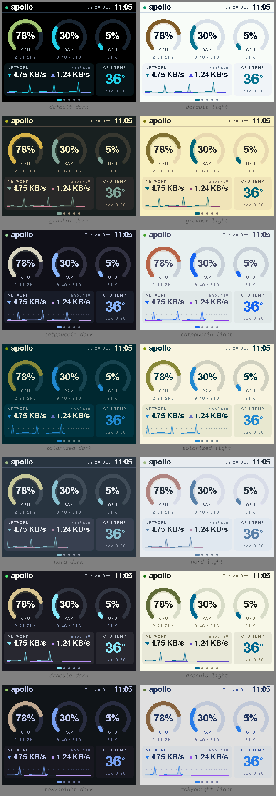

# Panoptes

**An all-seeing PC monitor for the ESP32 "Cheap Yellow Display."**

Panoptes turns a ~$15 ESP32-2432S028R ("CYD") into a small dashboard that runs off the PC it's
plugged into. A small agent on the PC sends CPU, RAM, GPU, temperatures, network, disk, fans,
top processes and battery to the board over **USB serial only**. The board's WiFi and Bluetooth
stay off: no network setup, no cloud, nothing to pair.

> Named after Argus Panoptes, the hundred-eyed giant of Greek myth who never stopped watching.



## Features

- **5 touch pages:** a dashboard with gauges, per-core CPU, a network and disk graph,
  sensors with top processes, and system info. Tap the left or right third of the screen, or
  swipe, to change page.
- **7 colour themes**, each with a dark and a light version: default, Gruvbox, Catppuccin,
  Solarized, Nord, Dracula and Tokyo Night. **Auto mode** picks light or dark from the board's
  light sensor. Tap the centre of the header to cycle themes.
- **Alerts:** a red banner and LED flash, plus an optional beep, when CPU temperature or load
  stays high.
- **RGB status LED** that follows CPU load, **auto-brightness**, and a **night mode** you
  toggle with a long press.
- **Cross-platform agent:** one static binary for Linux, macOS and Windows on amd64 and arm64.
  It reads NVIDIA and AMD GPUs, finds the board automatically, and can run as a login service.
- **`panoptes screenshot`** saves what the board is showing as a PNG.

## Quick start

1. **Flash the board.** Open the **[web flasher](https://dhruvinsh.github.io/panoptes/)** in
   Chrome or Edge and click *Flash*. Or use esptool with a `*-factory.bin` from the
   [latest release](https://github.com/dhruvinsh/panoptes/releases/latest):
   ```sh
   esptool --chip esp32 -b 460800 write-flash 0 panoptes-firmware-<ver>-st7789-factory.bin
   ```
   Boards sold under the same name ship with one of two display chips. If the picture is
   scrambled, flash the `ili9341` build instead.
2. **Install the agent.** Download it for your OS from
   [Releases](https://github.com/dhruvinsh/panoptes/releases/latest), or run
   `go install github.com/dhruvinsh/panoptes/cmd/panoptes@latest`.
3. **Run it:**
   ```sh
   panoptes                                # auto-detects the board
   panoptes --theme nord --theme-mode auto # pick a theme
   ```
   Or set it once in the config file (`~/.config/panoptes/config.toml`) so manual runs and the
   service both use it:
   ```toml
   #:schema https://raw.githubusercontent.com/dhruvinsh/panoptes/main/schema/config.schema.json
   theme = "catppuccin"
   theme_mode = "auto"
   ```
   ```sh
   panoptes install-service                # start at login (systemd / launchd / Task Scheduler)
   ```
   On Linux, if you get *permission denied*, install the udev rule:
   `sudo install -m644 packaging/70-panoptes.rules /etc/udev/rules.d/`. See
   [docs/host.md](docs/host.md) for per-OS notes.

## Repository layout

| Path | What |
|------|------|
| [cmd/panoptes](cmd/panoptes), [internal/](internal/) | Go host agent |
| [firmware/](firmware/) | PlatformIO + LovyanGFX firmware ([README](firmware/README.md)) |
| [PROTOCOL.md](PROTOCOL.md) | Newline-delimited JSON over 115200-baud serial |
| [docs/host.md](docs/host.md), [docs/config.example.toml](docs/config.example.toml) | Agent install, config file, services, sensors per OS, troubleshooting |
| [schema/](schema/) | JSON Schema for `config.toml` (editor completion), generated from the agent |
| [packaging/](packaging/) | udev rule (`/dev/panoptes`) |
| [web/](web/) | ESP Web Tools flasher, deployed to GitHub Pages on release |

## Building from source

```sh
go test ./... && go build ./cmd/panoptes           # agent
cd firmware && pio run -e cyd -t upload            # firmware (ST7789 board)
cd firmware && pio run -e paneltest -t upload      # can't tell which display chip? tap the mode that looks right
```

Releases are fully automated: pushing a `v*` tag builds the binaries with GoReleaser, attaches
the firmware images, and redeploys the web flasher.

## License

[MIT](LICENSE)
